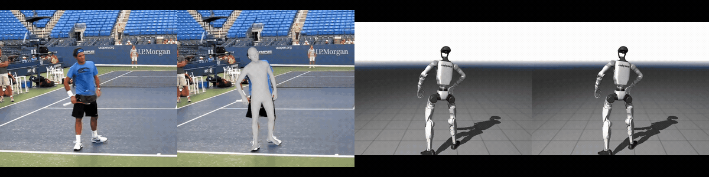
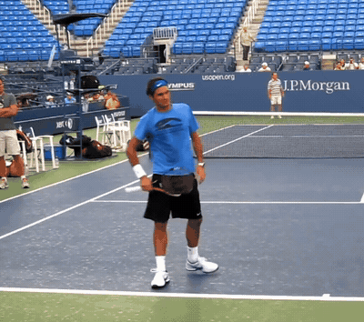
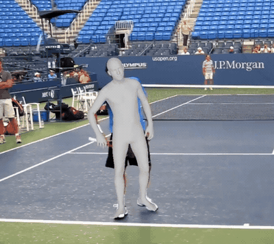
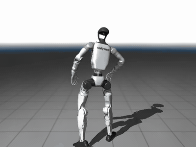
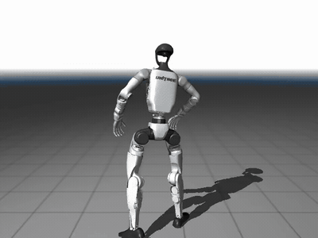

# rgb-to-humanoid

**Monocular RGB video → humanoid robot motion.** One phone-camera clip goes in, Unitree G1 joint trajectories come out, with no mocap suit, no depth sensor, and no multi-camera rig.

<p align="center">
  
  <br>
  <sub>Left to right: input video · GVHMR SMPL-X estimate · GMR retargeting to Unitree G1 · One Euro smoothing</sub>
</p>

The pipeline chains three stages, then packages the result for a whole-body controller:

```
 RGB video ──▶ GVHMR pose estimation ──▶ GMR retargeting ──▶ One Euro filter ──▶ SONIC reference stream
 (any camera)    (SMPL-X, world frame)    (Unitree G1 qpos)    (jitter removal)    (joint pos/vel + root quat, 50 Hz, ZMQ)
```

It runs offline on a video file or live from a webcam, where every frame is detected, lifted to 3D, retargeted, and rendered on the robot in MuJoCo in one loop. The final stage converts the trajectory into the reference format of NVIDIA's [GEAR-SONIC](https://github.com/NVlabs/GR00T-WholeBodyControl) tracking policy and streams it over ZMQ, so the motion can drive a physics-controlled G1 rather than a kinematic replay.

## Stages

<table>
  <tr>
    <td align="center" width="50%"><b>1 · Input</b><br><sub>Monocular RGB, 60 fps, moving subject</sub><br></td>
    <td align="center" width="50%"><b>2 · GVHMR pose estimation</b><br><sub>GVHMR SMPL-X estimate rendered over the input</sub><br></td>
  </tr>
  <tr>
    <td align="center" width="50%"><b>3 · GMR retargeting</b><br><sub>Unitree G1 tracking the SMPL-X motion (note the leg jitter)</sub><br></td>
    <td align="center" width="50%"><b>4 · One Euro smoothing</b><br><sub>Same motion after <code>smooth_robot_motion.py</code>; legs stay planted</sub><br></td>
  </tr>
</table>

| Stage | What happens | Code |
|---|---|---|
| Detect & track | YOLO person detection, primary-person tracking across frames, Gaussian-smoothed bounding boxes | `gvhmr_demo.py` |
| 2D + image features | ViTPose-S heatmaps → 17 COCO keypoints (UDP sub-pixel refinement); HMR2 ViT-H → 1024-d per-frame features | `vitpose_model.py`, `hmr2_model.py` |
| Camera motion | Static camera by default; `--no_static_cam` runs a SIFT + essential-matrix visual odometry to feed camera angular velocity | `gvhmr_demo.py` (`SimpleVO`) |
| 3D lifting | GVHMR RoPE-transformer denoiser → SMPL-X pose, shape and translation in both camera and world frame | `gvhmr_model.py` |
| World post-processing | Foot/hand contact classification, stationary-joint rollout, CCD inverse kinematics so planted feet do not slide, ground alignment | `gvhmr_model.py` |
| Temporal smoothing | Gaussian smoothing on SO(3) (rotation matrices + SVD projection) instead of on raw axis-angle, plus axis-angle continuity fixes to remove ±π flips | `gvhmr_model.py` |
| Retargeting | SMPL-X joints → Unitree G1 joint angles with GMR's IK, straight from this repo's `.npz` output | GMR `scripts/smplx_to_robot.py` |
| Jitter removal | Speed-adaptive One Euro filter on the robot joint trajectory; causal, so it also works live | `smooth_robot_motion.py` |
| Controller hand-off | Resample to 50 Hz, derive joint velocities, pack SONIC protocol v1 frames, validate and publish over ZMQ | `sonic/` |

## What is in this repo

`gvhmr_inference/` is a from-scratch, inference-only re-implementation of GVHMR and its upstream models. It has **no dependency on `hmr4d`, `pytorch3d`, `mmpose` or `mmcv`**; it needs only PyTorch, timm, einops, OpenCV, SciPy and Ultralytics.

| File | Lines | Contents |
|---|---|---|
| `gvhmr_model.py` | ~1,600 | GVHMR denoiser (RoPE attention encoder), SMPL forward kinematics on the 22-joint skeleton, contact-aware post-processing, CCD IK, SO(3) smoothing, all rotation utilities |
| `hmr2_model.py` | ~1,100 | HMR2 ViT-H backbone and SMPL transformer decoder head, used as the image feature extractor |
| `vitpose_model.py` | ~600 | ViTPose backbone + top-down heatmap head (S/B/H variants) |
| `gvhmr_demo.py` | ~1,100 | Offline video pipeline and the real-time webcam loop with live GMR retargeting |
| `gvhmr_visualize.py` | ~200 | SMPL-X mesh overlay renderer (in-camera, global, or side by side) |
| `smooth_robot_motion.py` | ~200 | One Euro filter over GMR robot motion, with a before/after jitter report and optional video render |
| `export_smpl_skeleton.py` | ~60 | One-time export of the SMPL neutral skeleton (`smpl_neutral_skeleton.npz`) that the FK uses |
| `GMR/` | submodule | [GMR](https://github.com/YanjieZe/GMR), pinned and installed as an editable dependency |
| `sonic/` | ~400 | GEAR-SONIC integration: GMR-to-SONIC converter, bundle validator, protocol v1 packer and ZMQ publisher (numpy + pyzmq only) |

Engineering details worth knowing:

- **Real-time mode.** The webcam loop keeps a rolling 120-frame window, carries the world translation anchor across window slides so the robot does not teleport, and smooths each output frame with an EMA (quaternion SLERP for orientations). A HUD shows per-stage latency for YOLO, features, GVHMR, SMPL-X FK, GMR and the viewer.
- **Rotation handling.** Every smoothing step is done on a continuous representation. Axis-angle sequences are made continuous before and after world-frame integration, and Gaussian smoothing is applied to rotation matrices then projected back to SO(3).
- **Diagnostics.** Each offline run also writes `*_foot_traj.png` and `*_foot_traj.npz` with foot height, foot XY paths, per-foot contact probability and the global root trajectory, which is how the contact and IK post-processing was tuned.
- **Output format.** The `.npz` uses the AMASS / SMPL-X layout (`root_orient`, `pose_body`, `trans`, `betas`, `gender`, `mocap_frame_rate`) in a z-up world frame, so GMR reads it with no conversion step.

## Quickstart

```bash
git clone --recurse-submodules https://github.com/donggeonk/rgb-to-humanoid.git
cd rgb-to-humanoid/gvhmr_inference
uv sync            # installs torch (cu126), ultralytics, GMR (editable from ../GMR), etc.
```

Download the checkpoints from the [GVHMR release](https://github.com/zju3dv/GVHMR) and a YOLO26 weight from Ultralytics, then place them as:

```
gvhmr_inference/checkpoints/
├── gvhmr/gvhmr_siga24_release.ckpt
├── hmr2/epoch=10-step=25000-001.ckpt
├── vitpose/vitpose-s.pth
└── yolo/yolo26s.pt            # yolo26n.pt for webcam mode
```

The SMPL-X body model (`SMPLX_NEUTRAL.npz`) goes under `GMR/assets/body_models/smplx/`, as described in the GMR README.

GVHMR's forward kinematics also needs `gvhmr_inference/smpl_neutral_skeleton.npz`, a 24-joint skeleton derived from the SMPL neutral body. Download `SMPL_NEUTRAL.pkl` from the [official SMPL site](https://smpl.is.tue.mpg.de/) (sign-up required) and export it once; the SMPL license does not allow shipping the result in this repo.

```bash
uv run python export_smpl_skeleton.py --smpl_pkl /path/to/SMPL_NEUTRAL.pkl
```

### 1. Video → SMPL-X

```bash
uv run python gvhmr_demo.py --video tennis.mp4 --out tennis.npz \
    --visualize tennis_overlay.mp4 --vis_mode side_by_side
```

Flags: `--no_static_cam` for a moving camera, `--no_smooth` to skip temporal smoothing, `--det_conf` for the detector threshold, `--device cpu` if you have no GPU.

### 2. SMPL-X → Unitree G1

```bash
cd ../GMR
python scripts/smplx_to_robot.py --smplx_file ../gvhmr_inference/tennis.npz \
    --robot unitree_g1 --save_path motions/tennis_g1.pkl --record_video
```

### 3. Smooth the robot motion

```bash
cd ../gvhmr_inference
uv run python smooth_robot_motion.py --input ../GMR/motions/tennis_g1.pkl \
    --output ../GMR/motions/tennis_g1_smoothed.pkl --joints legs \
    --record_video tennis_g1_smoothed.mp4
```

`--joints` takes `all`, `legs`, or comma-separated joint-name substrings; `--min_cutoff` and `--beta` tune the filter. The script prints the jitter score before and after.

### 4. Package for SONIC

```bash
cd ../sonic
pip install -r requirements.txt     # numpy, pyzmq
python gmr_to_sonic.py --input ../GMR/motions/tennis_g1_smoothed.pkl \
    --output outputs/tennis/sonic_stream_v1.npz
python run_sonic_from_output.py --input outputs/tennis --dry-run        # validate + print frames
python run_sonic_from_output.py --input outputs/tennis --publish --port 5556 --topic pose
```

The bundle holds `joint_pos`, `joint_vel` (29 G1 joints at 50 Hz), `body_quat` (wxyz) and `frame_index`, plus the joint-name order for checking against your deployment. The publisher packs each frame into SONIC's protocol v1 binary layout and streams it on a ZMQ PUB socket at the bundle's frame rate. This is an integration, not a verified demo: the SONIC policy itself runs through GR00T-WholeBodyControl on an Ubuntu machine with an NVIDIA GPU, and we have not yet closed the loop on hardware.

### Live webcam → robot

```bash
uv run python gvhmr_demo.py --webcam --robot unitree_g1
```

Opens the camera, runs the full pipeline per frame, and drives the G1 in GMR's MuJoCo viewer. Press `q` to quit.

## Earlier baseline

`vibe/` is a minimal inference-only re-implementation of [VIBE](https://github.com/mkocabas/VIBE) (ResNet-50 + temporal GRU + HMR head) with video and webcam demos. It was the first pose-estimation backend; GVHMR replaced it for its world-frame output and foot-contact handling.

## Acknowledgements

Built on [GVHMR](https://github.com/zju3dv/GVHMR) (Shen et al., SIGGRAPH Asia 2024), [GMR](https://github.com/YanjieZe/GMR) (Ze et al., 2025), [HMR2.0 / 4D-Humans](https://github.com/shubham-goel/4D-Humans), [ViTPose](https://github.com/ViTAE-Transformer/ViTPose), [Ultralytics YOLO](https://github.com/ultralytics/ultralytics), the [One Euro filter](https://gery.casiez.net/1euro/) (Casiez et al., CHI 2012) and [GEAR-SONIC](https://github.com/NVlabs/GR00T-WholeBodyControl) (NVIDIA, 2025). Model weights follow their original licenses.
